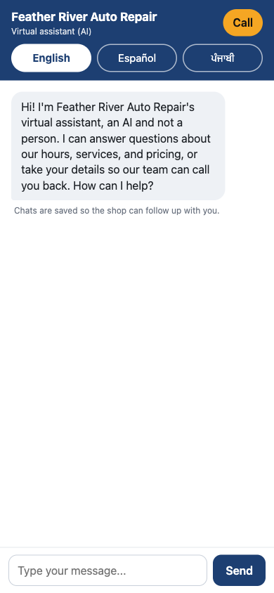
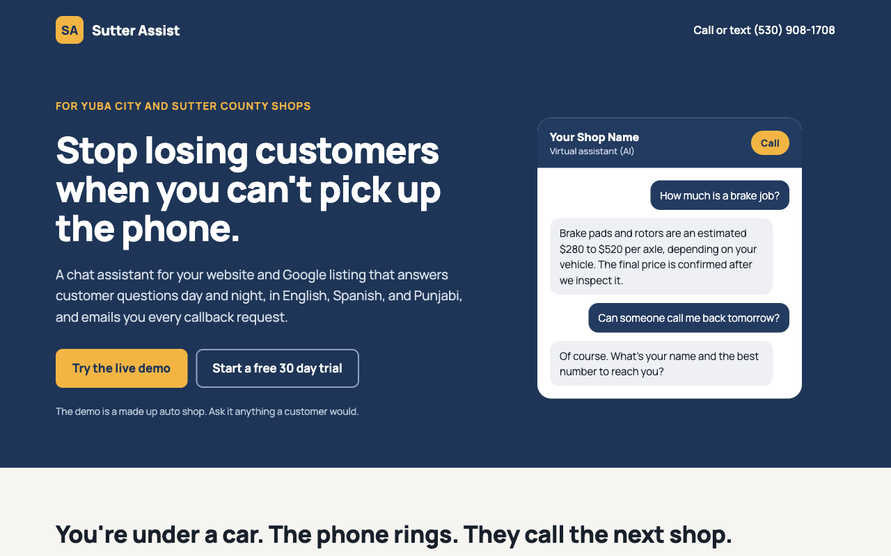

# Sutter Assist

Sutter Assist is an AI chat assistant for small local businesses such as auto shops and HVAC companies. When the owner is under a car or on a roof and can't pick up the phone, customers still get answers about hours, services and estimated prices at any hour, in English, Spanish or Punjabi, and anyone who wants a call back is captured as a lead and emailed to the owner. One FastAPI app serves many businesses, and onboarding a new client means adding one YAML file, not writing code.

- **Live demo:** [Feather River Auto Repair](https://business-chatbot-re10.onrender.com/b/feather-river-auto) (a made-up shop; try it on your phone)
- **Landing page:** https://business-chatbot-re10.onrender.com

| Chat on a phone (390px) | Landing page (desktop) |
|---|---|
|  |  |

## Highlights

- **Multi-business config:** one YAML file per client, validated at startup; a bad file stops startup instead of shipping a broken bot.
- **Claude tool use for lead capture:** the model calls a `save_lead` tool, the server validates it, writes the lead to disk first, then emails the owner (3 retries, with a fallback log).
- **English, Spanish and Punjabi:** replies match the customer's language, with a language switcher and all UI text in one file for native-speaker review.
- **Safety and crisis handling:** AI disclosure up front, emergency instructions (gas, fire, CO, brakes) before sales, 988/911 for self-harm, no invented prices or discounts, off-topic requests declined, and flagged conversations logged.
- **200+ tests plus live model evals:** a fast suite with a fake model client, and an opt-in suite that checks the real model on emergencies, off-topic requests and discount pressure.
- **Production deploy:** Render behind Cloudflare, per-visitor rate limits, global and per-business daily caps, salted IP hashing, and uptime monitoring.

**Tech stack:** Python 3, FastAPI, Uvicorn, Pydantic, Jinja2, YAML config, Anthropic Claude API (tool use), Gmail SMTP, pytest, pyright, Render.

## How a chat works

1. The visitor opens `/b/<slug>` (or the embedded bubble) and the page loads that business's name, phone, hours and languages from its YAML file.
2. Each message is checked first: length limit, per-visitor rate limit, daily caps, and a self-harm phrase check (used to flag the conversation and to keep 988/911 in the fallback reply if the model API fails).
3. The server builds a system prompt from the business file (services, prices, hours, open or closed right now, safety rules) and sends the conversation to Claude.
4. Claude answers only from that file, in the customer's language. If the customer wants a callback it calls the `save_lead` tool instead of replying with free text.
5. The server validates the tool call, saves the lead file, then emails the owner in the background and returns the result to Claude so it can confirm to the customer.
6. Replies pass output guards (code blocks stripped, friendly fallbacks with the shop's phone number on errors), and the conversation is appended to a per-business log for future monthly reports.

---

# Documentation

One FastAPI app that serves an AI chat assistant for many small businesses. Each business is a single YAML file in `businesses/`. Adding a client means adding a file, not changing code.

- Answers only from the business's file, in English, Spanish, or Punjabi (matches the customer).
- Opens every chat by saying it is the shop's virtual assistant (an AI).
- Answers plainly and only offers a callback or the phone number when it can't answer, the shop is closed, it's an emergency, or the customer asks.
- A language switcher (English / Español / ਪੰਜਾਬੀ) in the chat header, showing only the languages in the business's YAML `languages` list. It defaults to the browser's language, remembers the visitor's choice per business, and the bot replies in the chosen language unless the customer writes in another one.
- Takes callback requests (name, phone, problem, best time to call). Leads are saved to a file and emailed to the owner, and the customer is told the team will aim to call around their time, not given an exact promise.
- Two ways to use it: a mobile-friendly chat page at `/b/<slug>` (QR codes, Google listings) and a `<script>` tag that adds a chat bubble to any website.
- Every conversation is logged per business for future monthly reports.

## Setup

```bash
cd ~/chatbot-template
/opt/anaconda3/bin/python3 -m venv .venv      # project virtualenv (not conda)
source .venv/bin/activate
pip install -r requirements-dev.txt           # includes pyright
pyright --version                             # the pyright plugin needs this program installed
cp .env.example .env                          # then edit .env yourself
```

### `.env`

| Variable | Required | What it is |
|---|---|---|
| `ANTHROPIC_API_KEY` | yes | From console.anthropic.com |
| `GMAIL_ADDRESS` | for email | `kennethtang.leads@gmail.com` (sender) |
| `GMAIL_APP_PASSWORD` | for email | A Google *app password* (Google Account > Security > 2-Step Verification > App passwords). Not your normal password. |
| `OPERATOR_BCC_EMAIL` | optional | Your address. Gets a BCC copy of every lead from every business. |
| `DATA_DIR` | optional | Where leads and logs are written. Default `./data`. |
| `VISITOR_HASH_SALT` | optional | Random string used when hashing visitor IPs in logs. |
| `PUBLIC_BASE_URL` | optional | Public https address used in the chat-bubble script. Defaults to Render's `RENDER_EXTERNAL_URL`; set it if you use a custom domain. |
| `DAILY_MESSAGE_LIMIT` | optional | Most chat messages per day across all businesses (default 1000). Each business can set its own `daily_message_limit` in its YAML (default 300). At a limit the bot stops calling Claude and replies with the shop's phone number; the log gets one warning per day. Counts are in memory and reset on restart. |
| `TRUSTED_PROXY_HOPS` | optional | Proxies in front of the app. `render.yaml` sets 2 because Render sits behind Cloudflare (default elsewhere 1: use the last `X-Forwarded-For` entry; 0: ignore the header). |
| `LOG_LEVEL` | optional | `DEBUG`, `INFO` (default), `WARNING` or `ERROR`. App log lines go to stdout with a timestamp and logger name. |
| `LOG_CLIENT_IP_DEBUG` | optional | `1` logs the raw `X-Forwarded-For` for each chat request so you can verify the setting. Turn off afterwards. |

Without the Gmail values the app still runs and saves leads to disk, but sends no email (it logs a warning).

## Run locally

```bash
source .venv/bin/activate
uvicorn app.main:app --reload
```

- Chat page: http://127.0.0.1:8000/b/feather-river-auto (try `sutter-buttes-hvac` too)
- Embed test: open `examples/embed.html` in a browser while the app is running.
- Homepage (the Sutter Assist marketing page, `app/templates/landing.html`): http://127.0.0.1:8000/
- Health check: http://127.0.0.1:8000/healthz

## Add a client

1. Copy `businesses/feather-river-auto.yaml` to `businesses/<their-slug>.yaml` and edit it, **or** draft it from their website:
   ```bash
   python scripts/draft_business.py https://their-shop.com --slug their-slug
   ```
   This uses Claude Sonnet 5.5 to write `businesses/their-slug.draft.yaml`. Review it, fix every `# TODO: verify` line, and rename it to `their-slug.yaml`. Draft files are ignored by the app.
2. Restart the app. A bad file stops startup with the file name and the problem.
3. Give them the link and the script tag:
   ```html
   <script src="https://YOUR-APP.onrender.com/b/their-slug/widget.js" async></script>
   ```
   The chat page for QR codes and Google Business Profile is `https://YOUR-APP.onrender.com/b/their-slug`.

`not_offered:` in a business file is an optional list of things the shop clearly doesn't do (for example `body work and paint`, `RVs`). If a customer asks about one, the bot says plainly that the shop doesn't do it and doesn't offer a callback for it. Anything that is in neither `services` nor `not_offered` is "not sure", and the bot offers to take the customer's details.

To move a client to a stronger model, set `model: claude-sonnet-5-5` in their file (the default is `claude-haiku-5-5`).

## Where things are saved

```
data/<slug>/conversations/2026-10/<conversation-id>.jsonl   one line per message, with token usage
data/<slug>/leads/<timestamp>_<id>.json                      one file per lead
```

Visitor IPs are stored only as a salted hash. The start command uses `--no-access-log` so uvicorn doesn't write raw visitor IPs to the logs either (only `LOG_CLIENT_IP_DEBUG=1` does, temporarily). All file access is in `app/storage.py`; to move to a database, reimplement that class.

## Safeguards

- Secrets only in `.env` (git-ignored). The app won't start without the API key.
- Messages limited to 1000 characters; conversations to 30 customer messages.
- Rate limit per visitor: 10 per minute and 60 per day (in memory, so it assumes one server instance). The visitor IP is taken from the right end of `X-Forwarded-For` (anything to the left is client-supplied and can be faked). Render sits behind Cloudflare, so the header there is `client, cloudflare-ip` and `TRUSTED_PROXY_HOPS=2` (set in `render.yaml`) picks the client; verified on Render with a spoofed leftmost entry. The start command uses `--no-proxy-headers` so uvicorn doesn't rewrite the connection address from that header, and the fallback is the direct connection when there is no header. See `TRUSTED_PROXY_HOPS` below.
- Daily caps (see `DAILY_MESSAGE_LIMIT`) bound the worst-case Claude spend. Also set a monthly spend limit in the Anthropic Console.
- One lead per conversation: if the customer corrects something after the lead was saved, the same lead file is updated and you get an email whose subject starts "Updated lead" showing what changed. Repeating the same details sends nothing.
- Lead emails are tried up to 3 times. If all fail, the error is logged and a line is added to `data/<slug>/unsent_leads.log`; the lead itself is always in `data/<slug>/leads/`.
- A small notice under the greeting ("Chats are saved so the shop can follow up with you.", in all three languages, text in `app/i18n.py`) tells visitors chats are recorded. Have a lawyer check the wording for your clients, and decide how long to keep logs.
- Difficult messages (Rule 2): angry or profane customers get a calm reply and an offer to pass the concern to the owner; complaints are saved as leads whose problem starts with "Complaint:"; sexual/hateful messages get one neutral sentence; threats get "call 911" and the topic is dropped; self-harm gets 988/911 and no sales or lead capture. Threats and crisis messages are flagged: the conversation log gets a `flag` record, `data/<slug>/flagged.jsonl` lists them (one line per conversation), and the server log gets a `FLAGGED` warning with a one-way `ref` (not the conversation id) and the running count; `flagged.jsonl` holds both the `ref` and the conversation id so you can match them. Nobody is emailed automatically, so grep the log or check `flagged.jsonl` regularly.
- If Claude can't answer (API error, empty reply) and the customer's message matches a self-harm phrase, the fallback reply includes a 988/911 line in their language and the conversation is flagged `crisis` in code. The phrase list is in one file, `app/crisis.py`, so you can review and extend it (tests: `tests/test_crisis.py`).
- `/healthz` returns only `{"ok": true}`.
- Dependencies are pinned to exact versions in `requirements.txt`.
- Safety rule at the top of the prompt: for gas smells, smoke, fire, CO alarms, failing brakes, or overheating while driving, the bot first says to stop/leave and call 911 or the gas company, then gives the shop number.
- The bot never agrees to discounts, price matches, or unlisted prices/timelines, and calls every listed price an estimate.
- It politely declines off-topic requests (coding, homework, essays, other businesses, roleplay), never reveals its instructions, and code blocks are stripped by a guard even if the model produced one.
- API failures, refusals, and rate limits show a friendly message with the shop's phone number.

## Tests

```bash
pytest                                  # fast, no network, no API calls
RUN_LIVE_TESTS=1 pytest tests/test_live.py -v   # optional: calls the real model (costs a few cents)
pyright
```

The normal tests use a fake model client. The live tests check the real model's behavior on off-topic requests, emergencies, and discount pressure.

## Deploy on Render

1. Push this folder to a private GitHub repo (`.env` and `data/` are git-ignored).
2. In Render: **New > Blueprint**, pick the repo. It reads `render.yaml`. (Or create a Web Service by hand with build `pip install -r requirements.txt` and start `uvicorn app.main:app --host 0.0.0.0 --port $PORT --no-access-log --no-proxy-headers`.)
3. In the service's **Environment** tab, set `ANTHROPIC_API_KEY`, `GMAIL_APP_PASSWORD`, and optionally `OPERATOR_BCC_EMAIL`.
4. Render's disk is wiped on every deploy unless you attach a persistent disk. `render.yaml` attaches one at `/var/data` and sets `DATA_DIR=/var/data`; this needs a paid instance type. Lead emails are the backup if you skip the disk.
5. Open `https://<your-service>.onrender.com/healthz`, then `/b/feather-river-auto`.
6. **Re-check the rate-limit IP if Render's setup changes** (their header format isn't documented; it was verified as `client, cloudflare-ip`, so `TRUSTED_PROXY_HOPS=2`): set `LOG_CLIENT_IP_DEBUG=1`, send one chat from your phone on mobile data, and read the log line. `using=` must be your phone's public IP, and it must differ from the next visitor's. If it shows a Render or Cloudflare address, raise or lower `TRUSTED_PROXY_HOPS` until it is right, then remove the debug variable.
7. Adding a client later: add the YAML, commit, push. Render redeploys.

## Deployment status

- **Live:** https://business-chatbot-re10.onrender.com (Render, Blueprint from `render.yaml`).
- **Visitor IP:** `TRUSTED_PROXY_HOPS=2` verified on Render (`X-Forwarded-For` is `client, cloudflare-ip`; a spoofed leftmost entry is ignored). `LOG_CLIENT_IP_DEBUG` has been removed.
- **Monitoring:** UptimeRobot checks `/healthz`.
- **To do:**
  - Have a native speaker review `app/i18n.py` (Spanish and Punjabi text) and `app/crisis.py` (self-harm phrases).
  - Replace the demo businesses with real client files before printing any QR code.

## Notes

- **All Spanish and Punjabi interface text is in one file, `app/i18n.py`** (greeting with the AI disclosure, buttons, error messages). Have a native speaker review and edit it there; a test checks that no language is missing a string.
- Lead emails are retried 3 times; if all fail, see `data/<slug>/unsent_leads.log`. The lead file is always written first.
- Monthly reports are not built yet; `FileStorage.iter_conversations(slug, "2026-10")` is the hook for them.

---

Copyright (c) 2026 Kenneth Tang. All rights reserved.
